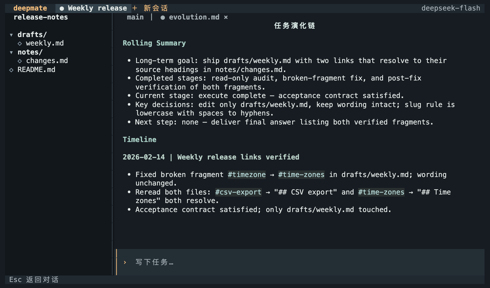
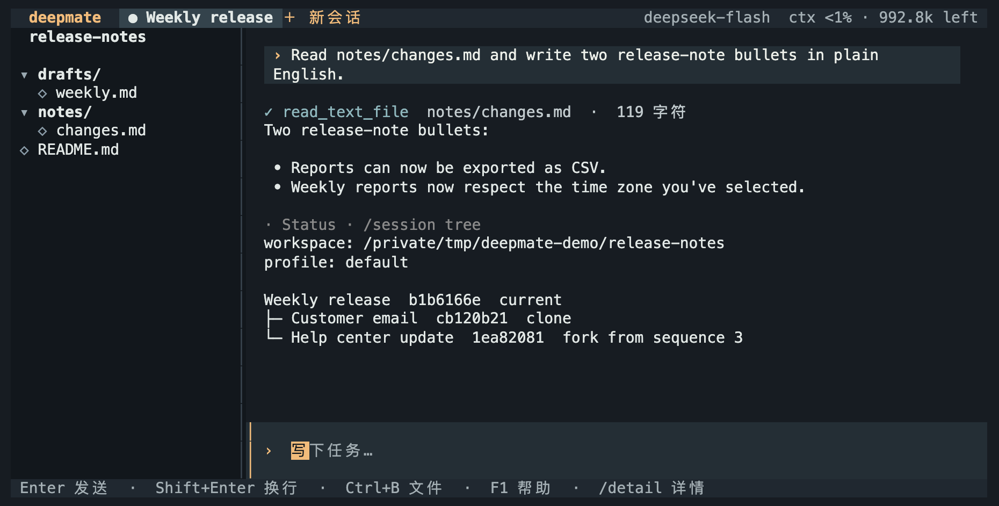
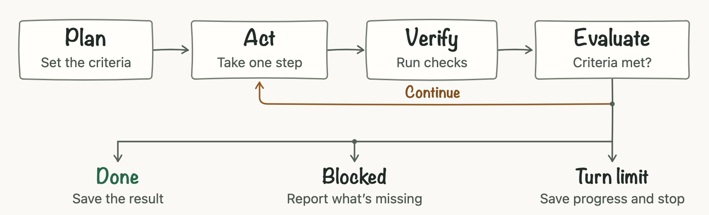
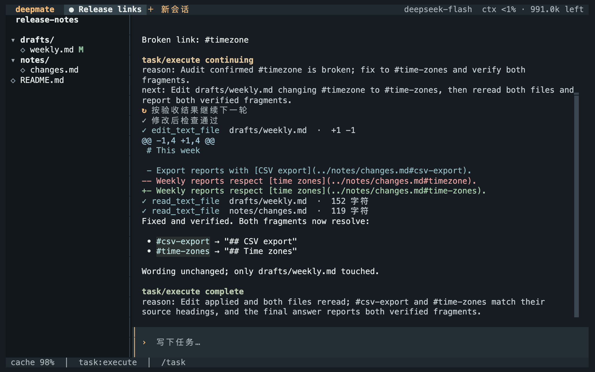

<p align="center">
  <a href="#license"></a>
  <a href="#install"></a>
  <a href="https://api-docs.deepseek.com/quick_start/pricing/"></a>
</p>

# Deepmate

Deepmate is a local AI workbench for long-running project work. Its terminal UI puts your files beside the conversation. Task Mode follows a plan, checks its work, and records the decisions made along the way. Run it with DeepSeek or a local model through Ollama.

## Highlights

- **Prefix cache** — Keep project instructions and memory stable across turns so the provider can reuse the start of a request. The top-right corner of the terminal shows how much context is left. When space runs low, Deepmate can summarize older messages and keep recent ones in full.
- **Cost governance** — Frequently used skills stay in the default list. The model can search MCP tools before loading their full definitions. If a test prints hundreds of lines, Deepmate keeps the full log on disk. The next turn gets a short preview and can look up the failing line.
- **Local model deployment** — Check disk space, resume or cancel Ollama downloads, and test a model before switching. Concurrent requests for the same model share one download.
- **Self-evolution** — Learn from repeated corrections and successful workflows. Deepmate can remember a preference, flag a recurring mistake, or turn a routine into a skill you can inspect and edit. The optional desktop pet shows task progress and lets you give feedback on its suggestions.

  <div><a href="assets/readme/desktop-pets-wide.png"></a></div>
- **Project history in Task Mode** — Open `task/plan.md` to see what’s done and what’s next. `task/evolution.md` keeps a running summary and a timeline of milestones, decisions from your discussions, and changes of direction. Task Mode saves a record of each checkpoint and completed task in `task/achievements/`.

  

## Install

Deepmate requires Python 3.11 or later. Set a DeepSeek API key for the cloud model, or run `deepmate` and use `/local` with Ollama.

```bash
pip install deepmate
export DEEPSEEK_API_KEY="<your-deepseek-api-key>"
deepmate
```

By default, `deepmate` opens the TUI and scopes file access, checkpoints, and
tool permissions to the current workspace. For a one-shot CLI check:

```bash
deepmate --cli "Summarize this project in one paragraph."
```

To run the development build, install from a checkout.

```bash
git clone https://github.com/kevin0x5/deepmate.git
cd deepmate
python3 -m pip install -e .
```

## Agent Evaluations

Deepmate provides a repository-level Agent evaluation suite under
[`evals/`](evals/OBJECTIVES.md), covering context management, long-running tasks,
tool governance, evolution, local models, and safety. It detects behavioral
regressions and verifies that the Deepmate Agent can complete tasks, use tools,
and recover from interruptions within defined constraints.

```bash
python3 -m evals validate
python3 -m evals run --preset pr
python3 -m evals report <run-id>
```

See [`evals/OBJECTIVES.md`](evals/OBJECTIVES.md) for the complete evaluation scope,
metrics, and usage.

## Features

Deepmate is in active development. Core CLI/TUI workflows are local-first; optional integrations such as Ollama, Computer Use, Enterprise WeChat, preview relays, and the desktop pet need their own setup.

| Capability | Description |
|------------|-------------|
| **LLM runtime** | Use DeepSeek V4 by default, stream responses, switch models per run, and keep provider-specific options such as thinking mode and reasoning effort explicit. |
| **Local model deployment** | Prepare, check, and switch Ollama-backed models from Deepmate, then use them in the same session, TUI, and tool workflow. |
| **Context management** | Assemble workspace rules, profile/project memory, task state, skills, MCP tools, files, and prior outputs into the current model turn. |
| **Context snapshot, prefix cache, and cost control** | Freeze workspace/profile context for a session, refresh it when needed, keep the stable prefix reusable, and compact large outputs behind retrievable refs. |
| **Task Mode** | Plan a goal, lock an acceptance contract, execute against it, and preserve decisions and achievements under `task/`. |
| **Workspace tools** | Read, edit, search, diff, inspect documents/tables, render reports/diagrams, run sandboxed shell checks, automate browser checks, and use LSP helpers. |
| **Skills** | Load repeatable `SKILL.md` workflows for PRDs, research briefs, reports, diagrams, architecture notes, advisors, and project-specific routines. |
| **MCP** | Discover configured MCP servers, load schemas on demand, run read-only tools by default, and opt in explicitly to write-capable tools. |
| **Memory** | Extract stable personal preferences, collaboration habits, recurring terminology, and durable working principles from user-authored text while filtering secrets, logs, and one-off task context. |
| **Subagents** | Delegate bounded subtasks with tool allowlists, expected outputs, and verification when parallel or isolated work helps. |
| **Checkpoints** | Persist transcripts, traces, and file checkpoints so workspace changes are inspectable, recoverable, and safe to rewind. |
| **Session tree** | Inspect session history and branch work with session tree, clone, and fork flows for alternate directions. |
| **Self-evolution** | Mine traces, sessions, activity notes, failures, and successful workflows to update behavior hints, failure guards, generated skill drafts, and capability state. |
| **Computer Use** | On macOS, explicitly allow real-screen observation and actions for UI validation or desktop workflows. |
| **Behavior learning** | Learn successful local tool and Computer Use paths, turn repeated operation flows into reusable workflows, and promote them into generated skill drafts. |
| **QA Audit** | Create a project-aware QA plan, edit cases, run available checks, generate reports, and turn findings into a Task Mode repair plan. |
| **Preview Deploy** | Serve generated HTML, reports, static build directories, or existing local services through local/LAN previews, with optional external relay support. |
| **TUI workbench** | Start with `deepmate` to work from a local interface with sessions, file browsing, previews, diffs, approvals, prompt queue, context usage, and slash commands. |
| **Desktop Pet** | Show current work state, lightweight progress feedback, reminders, and learning suggestions in a small desktop companion. |
| **Cron Jobs** | Schedule recurring workspace jobs from natural language or commands, approve before execution, and keep outputs local. |
| **Enterprise WeChat remote** | Bind remote conversations for long-running work, approvals, status checks, controlled remote commands, progress heartbeats, and wake locks while work is running. |
| **Hooks** | Apply governed lifecycle policies for approvals, blocking, tracing, checkpoints, memory/evolution signals, and trusted project rules. |
| **Observability** | Inspect local trace evidence, session details, token/cache signals, and optionally export spans to OTLP-compatible endpoints. |
| **Security** | Scope writes to the workspace, checkpoint before writes, gate shell/network/MCP writes, sanitize environments, and ask for approval on sensitive actions. |

## Configuration

You normally do not need to edit YAML before first use. Deepmate creates
`config/deepmate.yaml`, `config/providers.yaml`, and local profile files with
safe defaults when it first opens a workspace.

For DeepSeek, set the model key in your shell.

```bash
export DEEPSEEK_API_KEY="<your-deepseek-api-key>"
```

Check the base install and optional feature readiness without a model call:

```bash
deepmate --doctor
```

Edit `config/deepmate.yaml` or `config/providers.yaml` only when you want to
switch providers, tune context budgets, or override the internal summary/memory
models.

Override per run from the CLI when needed:

```bash
deepmate --model deepseek-v4-pro --thinking enabled --reasoning-effort max "Review this design."
```

Most daily work happens inside the TUI:

```bash
deepmate
```

Press Enter to send and Shift+Enter or Ctrl+J to add a line. Type `/` to browse commands with the arrow keys and complete one with Tab. In terminals narrower than 100 columns, Ctrl+B opens the file list, Enter opens a file, and Esc returns to the conversation. Wider terminals can show files and chat side by side.

Useful TUI commands:

```text
/local                         Prepare and switch to an Ollama-backed local model.
/local status                  Check the service, installed presets, download sizes, and last preparation result.
/task plan <goal>              Create or update task/plan.md.
/task execute                  Execute the current Task Mode plan.
/task status                   See what passed, what is still open, or why the task stopped.
/open task/evolution.md        Read the project summary and decision timeline.
/task checkpoint <note>        Save a stage achievement under task/achievements/.
/qa <goal>                     Create a QA Audit plan.
/qa run                        Run approved QA checks.
/cron add <schedule and job>   Create a recurring workspace job draft.
/deploy ./dist                 Open a local/LAN/external preview.
/pet setup                     Install or repair the desktop pet runtime.
/pet select cat                Switch to the cat. Other choices are dog, squirrel, and penguin.
/pet on                        Start the desktop pet window.
/session tree                  Inspect session lineage.
/session clone [title]         Copy the current discussion and continue in the copy.
/session fork <turn_id> [title]  Start a branch from an earlier turn.
/approvals                     Review approval history for the current session.
```

<details>
<summary>See how a release discussion branches into two conversations</summary>



</details>

A direct single-HTML preview serves only that selected file. For pages with relative
CSS, JavaScript, or image assets, preview a directory containing `index.html` instead.
Preview directory listings, sensitive paths, and symlink escapes are blocked.

## CLI Reference

The TUI is the default entry point. These CLI commands are available for scripts,
checks, or one-shot runs:

```bash
# Read-only inspection
deepmate --read-only-tools "Find the main runtime entry points."

# Workspace writes (checkpointed)
deepmate --workspace-write "Update the README wording."

# Shell (sandboxed, off by default)
deepmate --shell "Run the focused tests for the TUI."

# Task Mode from CLI
deepmate --task plan "Plan the next auth module changes."
deepmate --task execute "Implement the approved plan."
deepmate --task checkpoint "Archive the current stage as an achievement."

# QA Audit
deepmate --qa "Run a release-readiness audit for the web app."
deepmate --qa run

# Cron Jobs
deepmate --cron add "Every weekday at 09:00, summarize project status into reports/daily"
deepmate --cron approve <job-id>
deepmate --cron-runner --cron-watch

# Skills
deepmate --list-skills
deepmate --show-skill research-brief

# MCP
deepmate --list-mcp
deepmate --mcp-status

# Hooks
deepmate --hooks-status
deepmate --validate-hooks
deepmate --trust-workspace

# Remote (Enterprise WeChat)
deepmate --remote wecom

# Desktop pet
deepmate --pet-status
deepmate --pet

# Deploy preview is usually started from the TUI: /deploy ./dist

# Observability
deepmate --show-session <session-id> --trace-events 50
deepmate --show-session <session-id> --export-otlp --otlp-endpoint https://cloud.langfuse.com/api/public/otel
deepmate --validate-otlp --otlp-endpoint https://cloud.langfuse.com/api/public/otel

# Interactive session lineage
# In `deepmate`: /session tree, /tree, /session clone, /session fork

# Validate runtime with a real provider-backed smoke test
deepmate --validate-runtime --thinking disabled
```

## DeepSeek V4 Compatibility

- By default, Deepmate requests `deepseek-flash`, which currently serves **DeepSeek-V4.1-Flash-1017**. Use `--upgrade-model` to select `deepseek-v4-pro`.
- Context window: 1,000,000 tokens configured by default
- Reasoning: `thinking` and `reasoning_effort: max` supported
- No degraded-thinking workarounds recommended

[DeepSeek API docs](https://api-docs.deepseek.com/) · [Thinking mode](https://api-docs.deepseek.com/guides/thinking_mode) · [Pricing](https://api-docs.deepseek.com/quick_start/pricing)

## How It Works

Use `/task plan` to define what counts as done, then `/task execute` to start work. After each pass, Deepmate compares the evidence with the acceptance criteria. If there’s work it can still do, it takes another pass. If it’s blocked or reaches its turn limit, it stops and records why.

<picture>
  <source media="(max-width: 600px)" srcset="assets/readme/agent-loop-compact.png">
  
</picture>

In a release-notes example, the first pass found a link pointing to a missing heading. Task Mode fixed it on the next pass and checked both links before marking the task complete. On a later turn, Task Mode loads the current plan, the running summary, and recent entries from the project history.

<details>
<summary>See Task Mode fix and verify a release-note link</summary>



</details>

```text
User surfaces
  CLI, TUI, Enterprise WeChat, optional desktop pet
Runtime
  Builds bounded context, calls the model, runs approved tools, checkpoints writes, and records evidence
Capabilities
  Native tools, skills, MCP, browser automation, Computer Use, and subagents are loaded when useful
Workspace records
  task/, qa/, cron/, reports, checkpoints, transcripts, and traces keep work inspectable and recoverable
Optional integrations
  Ollama local models, preview relay, desktop pet, OpenTelemetry / Langfuse-compatible export
```

## Safety and Privacy

- API keys and remote secrets are read from environment variables or the private local
  secret store under `var/`; the desktop pet frontend does not inherit them.
- This repository ignores the default runtime directory, `var/`. Session transcripts there
  can include prompts, tool results, and model reasoning. When you use a cloud model,
  it receives the context Deepmate assembles for each request.
- Enterprise WeChat group conversations are session-isolated, inbound request IDs are
  deduplicated, and remote approvals can only be resolved by the requesting user.
- Desktop-pet learning sends coarse interest tags rather than raw current-work summaries;
  feedback is merged by the Python backend instead of directly overwriting shared state.
- Workspace writes are path-guarded and checkpointed.
- Shell, network, and MCP write tools are off by default and require explicit flags.
- Tool outputs can be compacted and retrieved by handle rather than replayed in full.
- Traces are written locally by default and can be exported to OpenTelemetry OTLP endpoints such as Langfuse when configured.

## License

MIT
