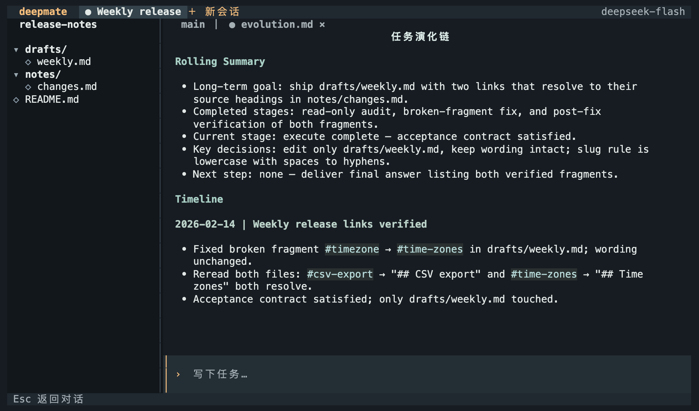
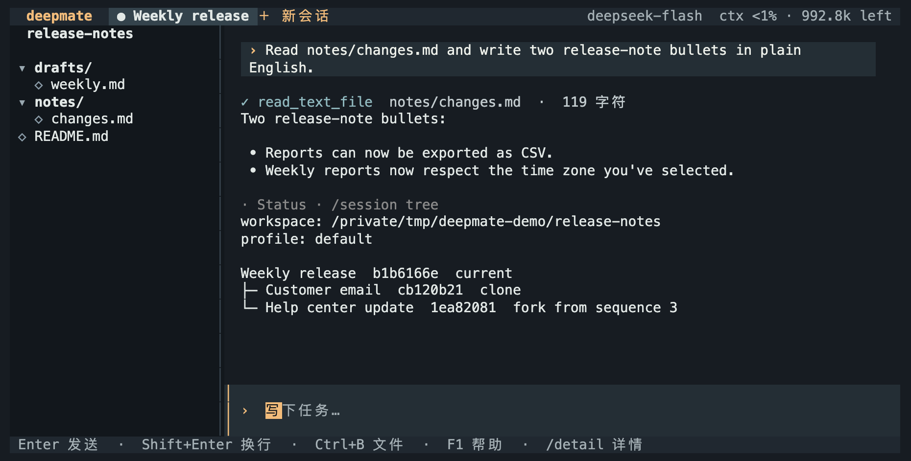
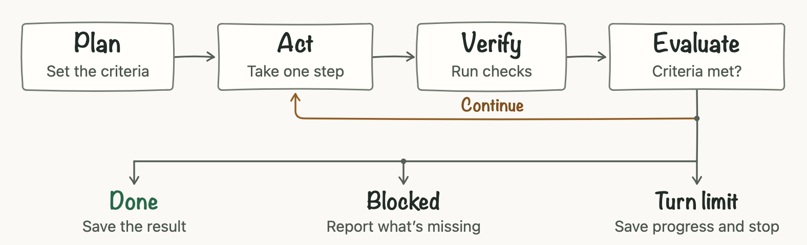
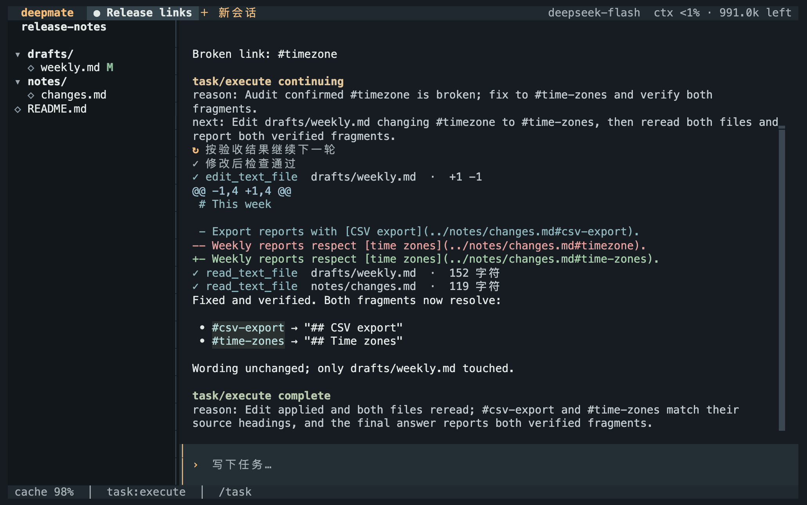

<p align="center">
  <a href="#许可证"></a>
  <a href="#安装"></a>
  <a href="https://api-docs.deepseek.com/quick_start/pricing/"></a>
</p>

# Deepmate

Deepmate 是面向长期项目的本地 AI 工作台。在终端里，你可以并排查看文件和对话。任务模式按计划执行，验证结果，并记下关键决策。你可以连接 DeepSeek，也可以用 Ollama 运行本地模型。

## 主要特色

- **前缀缓存**　同一会话中，项目指令和记忆在多轮对话间保持稳定，模型服务可以复用这段请求前缀。终端右上角会显示还剩多少上下文空间。空间吃紧时，Deepmate 可以把较早的消息整理成摘要，保留最近几轮的完整内容。
- **成本治理**　常用技能保留在默认列表里。模型可以先搜索 MCP 工具，用到哪个，再加载哪个的完整定义。即使一次测试输出了几百行，下一轮对话也只需带上一小段预览。完整日志保存在本地，需要时可以查回报错的那一行。
- **本地模型部署**　下载 Ollama 模型前可以检查磁盘空间，下载过程中可以取消，中断后可以续传。切换前可以先试跑模型。多个请求同时下载同一模型时，只需下载一份。
- **自进化**　Deepmate 可以从你反复纠正的问题和已经跑通的工作流程中学习。它可以记住你的偏好、提醒你留意反复出现的错误，也可以把常做的一套操作整理成技能，供你查看和修改。可选的桌面宠物会显示任务进度，你也可以告诉它哪些建议有帮助。

  <div><a href="assets/readme/desktop-pets-wide.png"></a></div>
- **项目演进与决策记录**　回到一个做了一半的项目，打开 `task/plan.md` 就能看到已经完成的工作和下一步。任务模式会在 `task/evolution.md` 里更新阶段摘要，按时间记下里程碑、讨论中作出的关键决策和方向变化。阶段检查点和最终成果保存在 `task/achievements/`。

  

## 安装

Deepmate 需要 Python 3.11 或更高版本。使用 DeepSeek 云端模型时，请设置 API 密钥。使用本地模型时，启动 `deepmate` 后输入 `/local` 即可通过 Ollama 配置模型。

```bash
pip install deepmate
export DEEPSEEK_API_KEY="<your-deepseek-api-key>"
deepmate
```

直接运行 `deepmate` 会打开终端界面（TUI）。文件访问、检查点和工具权限都以当前工作区为范围。也可以直接在命令行里提问，得到回答后退出。

```bash
deepmate --cli "用一段话概括这个项目。"
```

要使用开发版，可以克隆仓库并从源码安装。

```bash
git clone https://github.com/kevin0x5/deepmate.git
cd deepmate
python3 -m pip install -e .
```

## Agent 评测

仓库中的评测套件覆盖上下文管理、长任务、工具治理、自进化、本地模型和安全。它用于发现行为回归，并验证 Deepmate 能否在给定约束下完成任务、使用工具，以及在中断后恢复执行。评测套件位于 [`evals/`](https://github.com/kevin0x5/deepmate/blob/main/evals/OBJECTIVES.md)。

```bash
python3 -m evals validate
python3 -m evals run --preset pr
python3 -m evals report <run-id>
```

完整的评测范围、指标和用法见 [`evals/OBJECTIVES.md`](https://github.com/kevin0x5/deepmate/blob/main/evals/OBJECTIVES.md)。

## 功能列表

Deepmate 仍在持续开发。命令行和终端界面的核心工作流程以本地运行为主。Ollama、桌面操作、企业微信、预览中继和桌面宠物等可选功能需要单独配置。

| 功能 | 说明 |
|------|------|
| **模型运行时** | 默认使用 DeepSeek V4，支持流式输出，也可以为单次运行切换模型。思考模式、推理强度等模型服务特有的选项都可以显式设置。 |
| **本地模型部署** | 在 Deepmate 中准备、检查和切换 Ollama 模型，切换后可以在同一会话里继续使用原有的终端界面和工具。 |
| **上下文管理** | 为当前轮次组织模型需要的信息，包括工作区规则、用户和项目记忆、任务状态、技能、MCP 工具、文件及先前的输出。 |
| **上下文快照、前缀缓存与成本控制** | 会话可以冻结工作区和用户配置的上下文，按需刷新快照，使模型服务可以复用稳定的请求前缀。长输出可压缩成预览，并保留取回原文的引用。 |
| **任务模式** | 围绕目标制订计划，锁定验收标准，再按这些标准执行。决策和阶段性成果保存在 `task/` 中。 |
| **工作区工具** | 读写、搜索和比较文件，查看文档和表格，生成报告和图表。也可以在沙箱中运行 shell 检查、用浏览器自动执行检查，或使用语言服务器协议（LSP）工具。 |
| **技能（Skills）** | 从 `SKILL.md` 加载可复用的工作流程，用于撰写产品需求文档（PRD）、研究简报、报告和架构说明，也可用于绘图、顾问类任务和项目专用流程。 |
| **MCP** | 发现已配置的 MCP 服务，按需加载工具的参数定义。默认使用只读工具，具有写入能力的工具需要明确启用。 |
| **记忆** | 从用户自己撰写的文本中提取长期偏好、协作习惯、惯用术语和工作原则，过滤密钥、日志和仅与当次任务有关的信息。 |
| **子代理（Subagents）** | 适合并行或独立完成的子任务可以交给子代理。每项子任务都有明确的范围、允许使用的工具和预期产出，结果可以验证。 |
| **检查点** | 保存对话记录、执行轨迹和文件检查点，方便查看工作区发生了哪些改动，必要时可以恢复或回退。 |
| **会话树（Session Tree）** | 查看会话之间的分支关系。可以复制整场讨论再继续，也可以从先前某一轮另开分支，探索另一种方案。 |
| **自进化** | 从执行轨迹、会话、活动笔记、失败案例和成功流程中学习，据此更新行为提示、防错规则、自动生成的技能草稿和能力状态。 |
| **桌面操作（Computer Use）** | 在 macOS 上，经你明确授权后，Deepmate 可以查看实际屏幕并操作界面，用于验证 UI 或完成桌面任务。 |
| **行为学习** | 记录使用本地工具和操作桌面时成功的步骤，把反复出现的操作整理成可复用的流程，再生成技能草稿。 |
| **QA 审查** | 根据项目情况制订质量检查计划，编辑用例、运行可用检查并生成报告。发现的问题可以转成任务模式的修复计划。 |
| **预览部署** | 在本机或局域网预览生成的 HTML、报告、静态构建目录或已有的本地服务，也可以配置中继供外部访问。 |
| **终端工作台（TUI）** | 运行 `deepmate`，即可在终端中管理会话、浏览和预览文件、对比改动、处理审批，查看排队中的消息和上下文用量，也可以输入斜杠命令。 |
| **桌面宠物** | 在桌面上显示当前工作状态和进度，发送提醒，也会给出学习建议。 |
| **定时任务** | 用自然语言或命令安排周期性工作区任务。任务执行前需要审批，产出保存在本地。 |
| **企业微信远程连接** | 绑定企业微信会话后，可以远程跟进长任务、处理审批、查看状态或执行获准的命令。任务运行期间可定期报告进度，并防止设备休眠。 |
| **钩子（Hooks）** | 在运行周期的各个阶段应用规则，例如请求审批、阻止操作、记录执行轨迹或创建检查点。也可处理记忆和自进化信号，以及受信任的项目规则。 |
| **可观测性** | 查看本地执行轨迹、会话详情、token 用量和缓存信息，也可以把链路追踪片段（span）导出到兼容 OTLP 的服务。 |
| **安全控制** | 写入限制在工作区内，写入前会创建检查点。shell、网络和可写 MCP 工具受权限控制，传给工具的环境变量会经过筛选，敏感操作需要审批。 |

## 配置

首次使用通常无需手动编辑 YAML。第一次打开工作区时，Deepmate 会用安全的默认值创建 `config/deepmate.yaml`、`config/providers.yaml` 和本地用户配置文件。

使用 DeepSeek 时，在终端中设置 API 密钥。

```bash
export DEEPSEEK_API_KEY="<your-deepseek-api-key>"
```

可以先检查基础安装和可选功能是否就绪。此检查无需调用模型。

```bash
deepmate --doctor
```

如果要切换模型服务、调整上下文预算，或更换内部用于生成摘要和处理记忆的模型，请编辑 `config/deepmate.yaml` 或 `config/providers.yaml`。

也可以在命令行中只为本次运行指定模型和推理参数。

```bash
deepmate --model deepseek-v4-pro --thinking enabled --reasoning-effort max "帮我评审这个设计。"
```

日常使用可以直接打开终端工作台。

```bash
deepmate
```

按 Enter 发送消息，按 Shift+Enter 或 Ctrl+J 换行。输入 `/` 后，用方向键浏览命令，按 Tab 补全。终端宽度不足 100 列时，按 Ctrl+B 打开文件列表，按 Enter 打开文件，按 Esc 返回对话。较宽的终端可以并排显示文件和对话。

常用的 TUI 命令如下。

```text
/local                           准备并切换到由 Ollama 运行的本地模型。
/local status                    查看服务状态、已安装的预设、下载大小和最近一次准备结果。
/task plan <goal>                创建或更新 task/plan.md。
/task execute                    执行任务模式的当前计划。
/task status                     查看哪些检查已通过、还有哪些事项待办，以及任务为何停止。
/open task/evolution.md          查看项目的阶段摘要和决策时间线。
/task checkpoint <note>          把阶段性成果保存在 task/achievements/ 中。
/qa <goal>                       创建 QA 检查计划。
/qa run                          运行已批准的 QA 检查。
/cron add <schedule and job>     起草一项周期性工作区任务。
/deploy ./dist                   开启本机、局域网或外部预览。
/pet setup                       安装或修复桌面宠物的运行环境。
/pet select cat                  切换为小猫，也可以选择 dog、squirrel 或 penguin。
/pet on                          打开桌面宠物窗口。
/session tree                    查看会话的分支关系。
/session clone [title]           复制当前讨论，并在副本中继续。
/session fork <turn_id> [title]  从先前的某一轮对话另开分支。
/approvals                       查看当前会话的审批历史。
```

<details>
<summary>查看一次发布讨论怎样分出两场对话</summary>



</details>

直接预览单个 HTML 文件时，预览服务只会提供选中的文件。如果页面通过相对路径引用 CSS、JavaScript 或图片，请预览包含 `index.html` 的目录。预览服务会阻止列出目录内容、访问敏感路径，以及通过符号链接访问目录之外的文件。

## 命令行参考

默认入口是终端工作台。写脚本、运行检查或执行一次性任务时，可以使用以下命令。

```bash
# 以只读方式检查项目
deepmate --read-only-tools "找到程序运行时的主要入口。"

# 写入工作区，写入前创建检查点
deepmate --workspace-write "改进 README 的措辞。"

# 在沙箱中运行 shell，需显式启用
deepmate --shell "运行与 TUI 相关的测试。"

# 从命令行使用任务模式
deepmate --task plan "为认证模块的下一步改动制订计划。"
deepmate --task execute "实施已批准的计划。"
deepmate --task checkpoint "把当前阶段的成果归档。"

# QA 审查
deepmate --qa "检查这个 Web 应用是否已具备发布条件。"
deepmate --qa run

# 定时任务
deepmate --cron add "每个工作日 09:00 总结项目进展，保存到 reports/daily"
deepmate --cron approve <job-id>
deepmate --cron-runner --cron-watch

# 技能
deepmate --list-skills
deepmate --show-skill research-brief

# MCP
deepmate --list-mcp
deepmate --mcp-status

# 钩子
deepmate --hooks-status
deepmate --validate-hooks
deepmate --trust-workspace

# 远程连接（企业微信）
deepmate --remote wecom

# 桌面宠物
deepmate --pet-status
deepmate --pet

# 通常在 TUI 中输入 /deploy ./dist 启动预览

# 可观测性
deepmate --show-session <session-id> --trace-events 50
deepmate --show-session <session-id> --export-otlp --otlp-endpoint https://cloud.langfuse.com/api/public/otel
deepmate --validate-otlp --otlp-endpoint https://cloud.langfuse.com/api/public/otel

# 在终端工作台中查看会话树、复制会话或创建分支
# 进入 deepmate 后可用 /session tree、/tree、/session clone 和 /session fork

# 通过实际调用模型服务做一次基本运行检查
deepmate --validate-runtime --thinking disabled
```

## DeepSeek V4 兼容性

- 默认请求的模型是 `deepseek-flash`，目前对应 **DeepSeek-V4.1-Flash-1017**。使用 `--upgrade-model` 可以切换到 `deepseek-v4-pro`。
- 上下文窗口默认配置为 1,000,000 个 token。
- 支持 `thinking` 思考模式，推理强度可设为 `reasoning_effort: max`。
- 不建议通过降低模型的思考能力来规避问题。

[DeepSeek API 文档](https://api-docs.deepseek.com/) · [思考模式](https://api-docs.deepseek.com/guides/thinking_mode) · [定价](https://api-docs.deepseek.com/quick_start/pricing)

## 工作原理

先用 `/task plan` 约定怎样才算完成，再用 `/task execute` 开始执行。每轮结束后，Deepmate 都会拿检查结果对照验收标准。还有能做的事，就带着具体的下一步再做一轮。遇到阻塞或用完执行轮数，就停下来记录原因。

<picture>
  <source media="(max-width: 600px)" srcset="assets/readme/agent-loop-compact.png">
  
</picture>

以检查发布说明为例。第一轮发现一条链接指向不存在的标题。第二轮修正链接后，又逐一检查了草稿中的两条链接，确认都能跳到对应标题才标记完成。下次用任务模式接着做时，Deepmate 会载入当前计划、阶段摘要和最近几条项目记录。

<details>
<summary>查看任务模式如何修复并验证发布说明中的链接</summary>



</details>

```text
使用入口
  命令行、终端工作台、企业微信，以及可选的桌面宠物
运行时
  按预算组装上下文，调用模型，运行已获准的工具，在写入前创建检查点并记录执行依据
可调用的能力
  按需加载内置工具、技能、MCP、浏览器自动化、桌面操作和子代理
工作区记录
  task/、qa/、cron/、报告、检查点、对话记录和执行轨迹，供后续查看或恢复工作
可选集成
  Ollama 本地模型、预览中继、桌面宠物，以及兼容 OpenTelemetry / Langfuse 的数据导出
```

## 安全与隐私

- API 密钥和远程连接凭据从环境变量或 `var/` 下的本地私密存储读取。桌面宠物前端不会继承这些凭据。
- 运行数据默认保存在 `var/`，本仓库已将其加入 Git 忽略规则。会话记录可能包含提示词、工具结果和模型推理内容。使用云端模型时，Deepmate 会把每次请求所需的上下文发送给模型服务商。
- 企业微信群聊之间的会话彼此隔离。收到的请求会按 ID 去重，远程审批只能由发起请求的用户处理。
- 桌面宠物的学习功能只发送概括性的兴趣标签，当前工作的原始摘要留在本地。反馈由 Python 后端合并，避免直接覆盖共享状态。
- 写入工作区前会检查目标路径，并创建检查点。
- shell、网络和可写的 MCP 工具默认关闭，需通过相应参数显式启用。
- 工具输出可以压缩后带入对话，需要时再按引用取回完整内容。
- 执行轨迹默认保存在本地。配置导出后，可以把它们发送到支持 OpenTelemetry OTLP 的服务，例如 Langfuse。

## 许可证

MIT
